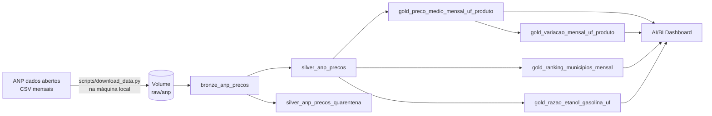

# Design

## Visão geral

## Armazenamento

- Catalog padrão do Free Edition: `workspace`. Schema: `anp_combustiveis`. Volume: `raw`.
- Arquivos em `/Volumes/<catalog>/<schema>/raw/anp/<ano>/<arquivo>.csv`.
- Catalog, schema e volume são parâmetros (variáveis do bundle e widgets dos notebooks).

## Fonte de dados

Os links estão na página da ANP (`.../dados-abertos/serie-historica-de-precos-de-combustiveis`).
Os nomes de arquivo mudam entre anos (`precos-gasolina-etanol-01.csv` em 2023-2025,
`06-dados-abertos-precos-2026-06-...` em 2026). Por isso o script descobre os links
lendo a página, em vez de montar URLs. Os servidores da ANP respondem 403 sem
`User-Agent` de navegador.

Formato: `;` como separador, BOM UTF-8, datas `dd/MM/yyyy`, decimal com vírgula.
Colunas: Regiao - Sigla, Estado - Sigla, Municipio, Revenda, CNPJ da Revenda, Nome da Rua,
Numero Rua, Complemento, Bairro, Cep, Produto, Data da Coleta, Valor de Venda,
Valor de Compra, Unidade de Medida, Bandeira.

Todas as tabelas ficam no mesmo schema, com prefixo da camada (`bronze_`, `silver_`, `gold_`).`n`n## Módulos (`src/anp_pipeline/`)

| Módulo | Responsabilidade |
|---|---|
| `quality.py` | Regras como expressões Spark; `apply_quality_rules(df)` devolve `(válidos, inválidos)`; lista UFs válidas |
| `bronze.py` | `normalize_column_name`, `read_raw_csv`, `add_ingestion_metadata`, `write_bronze` (replaceWhere por arquivo) |
| `silver.py` | `clean_and_type`, `deduplicate`, `build_silver`, `merge_silver` (MERGE INTO), `write_quarantine` |
| `config.py` | Nomes de tabelas e caminho do Volume a partir de catalog e schema |`n| `gold.py` | Funções puras que geram cada tabela gold a partir da silver, e `write_gold` |

Funções de transformação são puras (DataFrame in → DataFrame out). Efeitos de I/O ficam
em funções `write_*`/`merge_*` finas, para que os testes locais não precisem de Delta.

## Decisões de idempotência

| Camada | Estratégia | Motivo |
|---|---|---|
| Bronze | `replaceWhere _source_file IN (...)` | Reingestão de um arquivo substitui só as linhas dele. A ANP atualiza arquivos já publicados |
| Silver | `MERGE INTO` pela chave `cnpj, produto, data_coleta`, lendo só bronze com `_ingested_at` maior que o máximo da silver | Incremental e sem duplicar |
| Quarentena | `replaceWhere _source_file IN (...)` | Mesmo critério do bronze |
| Gold | Overwrite completo da tabela a partir da silver | Agregados determinísticos e pequenos. Variação e ranking dependem de janelas sobre vários meses |

## Silver: regras de transformação

- Colunas renomeadas para: `regiao, uf, municipio, revenda, cnpj, logradouro, numero, complemento, bairro, cep, produto, data_coleta, valor_venda, valor_compra, unidade_medida, bandeira`.
- Parsing seguro (`try_cast`, `try_to_timestamp`) para não quebrar com ANSI mode (padrão em serverless). Valores inválidos viram nulo e caem na quarentena.
- A quarentena guarda os valores originais de data e preço (`raw_data_coleta`, `raw_valor_venda`) e o array `_dq_failures`.

## Gold

1. `preco_medio_mensal_uf_produto`: `mes, uf, produto, unidade_medida, preco_medio, preco_min, preco_max, qtd_coletas, qtd_postos`.
2. `variacao_mensal_uf_produto`: acrescenta `preco_mes_anterior` e `variacao_pct`, só quando o mês anterior é o mês imediatamente anterior.
3. `ranking_municipios_mensal`: `mes, produto, unidade_medida, uf, municipio, preco_medio, qtd_postos, rank_mais_caro, rank_mais_barato`, com mínimo de postos por município (padrão 3).
4. `razao_etanol_gasolina_uf`: `mes, uf, preco_etanol, preco_gasolina, razao, etanol_compensa` (razão ≤ 0,70).

## Orquestração

`databricks.yml` define variáveis (`catalog`, `schema`), schema e volume (Unity Catalog), e o job
`anp_medallion` com três `notebook_task` em compute serverless: `bronze → silver → gold`.
Alvo `dev` (padrão). Autenticação via perfil do CLI ou `DATABRICKS_HOST`/`DATABRICKS_TOKEN`.

## Testes e CI

- `pytest` com `pyspark` local (`tests/conftest.py` cria a SparkSession), dados sintéticos pequenos.
- CI: Python 3.11, Java 17, `ruff check`, `ruff format --check`, `pytest`.

## Riscos

- O Free Edition pode mudar limites de compute e acesso à internet. O download local evita essa dependência.
- A ANP pode renomear arquivos. A descoberta de links pela página reduz o risco.
