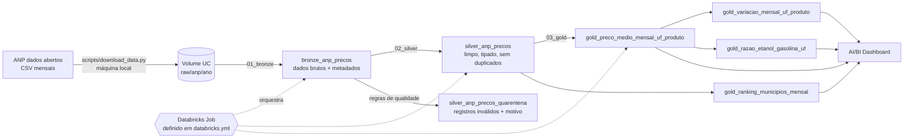

# Preços de combustíveis no Brasil: pipeline Medallion no Databricks

[](https://github.com/JFcamp/anp-combustiveis-databricks/actions/workflows/ci.yml)

## Summary (English)

End-to-end data engineering project on **Databricks Free Edition**: a Medallion pipeline
(bronze → silver → gold) built with **PySpark, Spark SQL, Delta Lake and Unity Catalog**,
orchestrated by a **Databricks Asset Bundle** job. The source is the public fuel price
time series published by Brazil's oil regulator (**ANP**, open data). The raw CSVs are kept in
a Unity Catalog Volume, cleaned and validated in silver (bad rows go to a quarantine table
with the failed rule), and aggregated into four analytical gold tables that feed an AI/BI
dashboard. Writes are idempotent (`replaceWhere` in bronze, `MERGE INTO` in silver, full
overwrite of deterministic aggregates in gold). Transformation logic lives in tested Python
modules (`pytest` + local PySpark), with `ruff` and tests running on GitHub Actions.

---

## Problema e objetivo

A ANP publica todo mês os preços de revenda de gasolina, etanol, diesel, GNV e GLP coletados
em postos de todo o país. Os arquivos são CSVs grandes (cerca de 10 MB por mês e por grupo de
produtos), com separador `;`, decimal com vírgula, datas `dd/MM/yyyy` e nomes de colunas
com espaços. Eles não estão prontos para análise.

Este projeto transforma esses arquivos em tabelas confiáveis e responde perguntas como:

- Quanto o preço médio de cada combustível variou de um mês para o outro em cada estado?
- Quais municípios têm os preços mais altos e mais baixos?
- Em quais estados o etanol compensa mais que a gasolina (regra dos 70%)?

## Arquitetura



O job `anp-medallion-pipeline` executa três tarefas em sequência (`bronze → silver → gold`) em
compute serverless.

## Stack

| Camada | Tecnologia |
|---|---|
| Plataforma | Databricks Free Edition, Unity Catalog (catalog, schema, Volume) |
| Processamento | Python 3.11, PySpark, Spark SQL |
| Armazenamento | Delta Lake |
| Orquestração e deploy | Databricks Asset Bundles (`databricks.yml`) |
| Testes | pytest, PySpark local, delta-spark (integração) |
| Qualidade de código e CI | ruff, GitHub Actions |
| Consumo | Databricks AI/BI Dashboard |

## Estrutura do repositório

```
├── databricks.yml            # bundle: schema, volume e job bronze -> silver -> gold
├── src/anp_pipeline/         # lógica testável
│   ├── bronze.py  silver.py  gold.py  quality.py  config.py
├── notebooks/                # notebooks finos, só chamam src/
├── sql/                      # queries do dashboard
├── scripts/download_data.py  # baixa os CSVs da ANP e envia ao Volume
├── tests/                    # pytest
├── .github/workflows/ci.yml  # ruff + pytest
└── .kiro/specs/anp-medallion # requirements, design e tasks (spec-driven development)
```

## Como rodar, passo a passo

### 1. Criar a conta no Databricks Free Edition

1. Acesse <https://www.databricks.com/learn/free-edition> e crie a conta (e-mail ou Google/Microsoft).
2. Ao entrar, você terá um workspace com o catalog `workspace` e compute serverless.
3. Anote a URL do workspace, no formato `https://<id>.cloud.databricks.com`.

### 2. Preparar a máquina local

Requisitos: Python 3.11+, Git e o [Databricks CLI](https://docs.databricks.com/aws/en/dev-tools/cli/install).

```bash
git clone https://github.com/JFcamp/anp-combustiveis-databricks.git
cd anp-combustiveis-databricks
python -m venv .venv
source .venv/bin/activate        # Windows (PowerShell): .\.venv\Scripts\Activate.ps1
pip install -r requirements.txt

databricks auth login --host https://<id>.cloud.databricks.com
```

O login abre o navegador (OAuth). Nenhum token é gravado no repositório. Em CI ou scripts,
use as variáveis `DATABRICKS_HOST` e `DATABRICKS_TOKEN`.

### 3. Fazer o deploy do bundle (cria schema, Volume e job)

```bash
databricks bundle validate
databricks bundle deploy
```

Se preferir não usar o bundle para o schema e o Volume, rode o notebook `notebooks/00_setup.py`
no workspace.

### 4. Baixar os CSVs e enviar ao Volume

O compute serverless do Free Edition pode ter acesso restrito à internet. Por isso o download
acontece na sua máquina:

```bash
# padrão: 2025-01 a 2025-12, grupos gasolina-etanol e diesel-gnv
python scripts/download_data.py \
  --upload-to /Volumes/workspace/anp_combustiveis/raw/anp
```

Opções úteis: `--start 2024-01 --end 2025-12`, `--groups gasolina-etanol diesel-gnv glp`,
`--dry-run` (só lista os arquivos). Sem `--upload-to`, os arquivos ficam em `data/raw/`
e você pode enviá-los pela interface (Catalog > workspace > anp_combustiveis > raw > Upload).

> O script descobre os links lendo a página da ANP, porque o padrão de nome dos arquivos muda
> de um ano para outro.

### 5. Rodar o pipeline

```bash
databricks bundle run anp_medallion
```

Ou abra **Jobs & Pipelines** no workspace, escolha `anp-medallion-pipeline` e clique em **Run now**.
Rodar o job duas vezes seguidas não duplica dados.

### 6. Montar o dashboard

Siga [`sql/README.md`](sql/README.md): crie um AI/BI Dashboard com um dataset para cada arquivo
`.sql` e adicione os gráficos sugeridos.

### 7. Rodar os testes localmente

Os testes precisam de **Java 17 ou 21** instalado (PySpark 4.0 ainda não suporta o Java 25).

```bash
ruff check . && ruff format --check .
pytest -v
```

No Windows, os testes de integração com Delta são pulados (precisam de `winutils`). Eles
rodam no CI em Linux.

## Decisões técnicas

**Por que Medallion?** Cada camada tem uma responsabilidade clara. A bronze guarda o dado
exatamente como chegou, então qualquer erro de limpeza pode ser corrigido reprocessando a
partir dela. A silver concentra as regras de qualidade. A gold entrega tabelas pequenas,
já agregadas, para dashboards.

**Por que Delta Lake?** Dá transações ACID, `MERGE INTO`, `replaceWhere` e histórico de versões.
Sem isso, escrita idempotente em arquivos soltos exigiria código manual de deduplicação.

**Por que MERGE na silver?** A chave de negócio é `(cnpj, produto, data_coleta)`. O `MERGE` insere
linhas novas e atualiza as existentes quando a ingestão é mais recente. A silver só lê da bronze
o que chegou depois da última carga (`_ingested_at`), então a carga é incremental.

**Por que `replaceWhere` na bronze e na quarentena?** A ANP republica arquivos de meses
anteriores. Ao reingerir um arquivo, só as linhas dele (`_source_file`) são substituídas, sem
tocar nos outros.

**Por que overwrite na gold?** As tabelas são agregados determinísticos e pequenos. Variação
mensal e ranking usam janelas sobre vários meses, então recalcular tudo é mais simples e
seguro que um merge parcial. O resultado é o mesmo a cada execução.

**Por que download local?** O compute serverless do Free Edition pode bloquear acesso à internet,
e a ANP recusa clientes sem `User-Agent` de navegador. Baixar localmente e enviar ao Volume
elimina as duas dependências.

**Por que parse seguro?** O serverless roda com ANSI mode, em que um `CAST` inválido derruba
o job. A silver usa `try_cast` e `try_to_timestamp`: o valor inválido vira nulo e a linha
vai para a quarentena, com o valor original preservado.

**Código modular.** A lógica fica em `src/anp_pipeline/` como funções que recebem e devolvem
DataFrames. Os notebooks só leem parâmetros e chamam essas funções. Os testes cobrem as
funções diretamente.

## Regras de qualidade de dados

As regras estão em `src/anp_pipeline/quality.py`. Uma linha que falha em qualquer regra vai
para `silver_anp_precos_quarentena`, com todas as regras falhadas na coluna `_dq_failures` e os
valores originais de data e preço em `raw_data_coleta` e `raw_valor_venda`.

| Regra | Condição para passar |
|---|---|
| `valor_venda_positivo` | `valor_venda` não nulo e maior que 0 (preço ilegível vira nulo e reprova) |
| `valor_venda_plausivel` | `valor_venda` menor ou igual a 1000 (limite de sanidade; o GLP P13 chega a centenas de reais) |
| `uf_valida` | `uf` é uma das 27 UFs |
| `data_coleta_valida` | data com formato `dd/MM/yyyy` válido e não futura |
| `produto_preenchido` | `produto` não nulo |
| `cnpj_preenchido` | CNPJ com 14 dígitos (formatação removida) |

Outros tratamentos na silver: nomes em snake_case, textos aparados e em maiúsculas, vazio
vira nulo, vírgula decimal vira ponto, preços em `decimal(10,4)`, datas em `date` e remoção
de duplicados pela chave `(cnpj, produto, data_coleta)`, mantendo a ingestão mais recente.

## Tabelas gold

| Tabela | Conteúdo |
|---|---|
| `gold_preco_medio_mensal_uf_produto` | Preço médio, mínimo e máximo, nº de coletas e de postos por mês, UF e produto |
| `gold_variacao_mensal_uf_produto` | Variação % do preço médio contra o mês imediatamente anterior (nula se faltar o mês anterior) |
| `gold_ranking_municipios_mensal` | Ranking de municípios mais caros e mais baratos por mês e produto (mínimo de 3 postos) |
| `gold_razao_etanol_gasolina_uf` | Razão etanol/gasolina por UF e mês, com indicador de que o etanol compensa (razão até 0,70) |

## Exemplos de insights

> **Ainda não preenchido.** Os números abaixo precisam vir de queries executadas por você no
> seu workspace depois de rodar o pipeline. Não inclua valores que você não tenha visto
> nos resultados.

| Pergunta | Query | Resultado |
|---|---|---|
| Preço médio nacional da gasolina no último mês | `sql/01_preco_medio_brasil_por_produto.sql` | _preencher após executar_ |
| UF com gasolina mais cara e mais barata | `sql/02_preco_medio_por_uf.sql` | _preencher após executar_ |
| Município mais caro para etanol | `sql/04_ranking_municipios_mais_caros.sql` | _preencher após executar_ |
| UFs em que o etanol compensa | `sql/06_etanol_vs_gasolina.sql` | _preencher após executar_ |
| Registros em quarentena e motivo mais comum | `sql/07_qualidade_de_dados.sql` | _preencher após executar_ |

## Dashboard

_Adicione aqui os prints do dashboard (salve em `docs/img/`)._

| Visão geral | Ranking de municípios | Etanol vs. gasolina |
|---|---|---|
|  |  |  |

## Status de verificação

| Item | Situação |
|---|---|
| Testes unitários (transformações e qualidade) com PySpark local | Executados |
| Queries SQL em Spark local com dados sintéticos | Executadas |
| Testes de integração com Delta (idempotência de bronze, silver e quarentena) | Executados no CI (Linux): 40 testes passaram, sem testes pulados |
| `databricks bundle validate`/`deploy` e execução do job no workspace | A executar por você (passos 3 a 5) |
| Dashboard AI/BI | A montar por você (passo 6) |

## Fonte dos dados

Série Histórica de Preços de Combustíveis e de GLP, da
[ANP](https://www.gov.br/anp/pt-br/centrais-de-conteudo/dados-abertos/serie-historica-de-precos-de-combustiveis),
publicada como dados abertos. Os CSVs não são versionados neste repositório.

## Licença

MIT. Veja o arquivo `LICENSE`.
